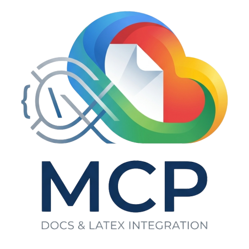

<div align="center">
  

# MCP TCC — Google Docs ↔ LaTeX Bridge

  <p>
    
    
    
  </p>

  <p><b>Automatize a ponte entre a escrita criativa no Google Docs e a compilação acadêmica em LaTeX, usando Inteligência Artificial.</b></p>
</div>

<br>

O **TCC DocsLaTeX Bridge** é um servidor [Model Context Protocol (MCP)](https://modelcontextprotocol.io/) desenhado especificamente para ajudar na criação de teses, dissertações e TCCs. Ele fornece a agentes de IA — como o **Claude Desktop** ou o **Cursor IDE** — o poder de ler, estruturar, comentar e modificar seus documentos do Google Docs de forma atômica e segura, bem como salvar as versões finais no seu repositório local em `.tex`.

Tudo isso encapsulado em um **único executável**, eliminando a necessidade de preparar complexos ambientes em Python ou Node.js.

---

## ✨ Arsenal de Ferramentas Disponíveis

O servidor conta com um portfólio robusto de **18 ferramentas avançadas** para maximizar o fluxo de edição da IA e garantir conformidade acadêmica com a ABNT:

### 📖 Descoberta e Leitura

- **`list_available_documents`**: Lista os documentos do Google Docs e os arquivos PDF compartilhados com o robô. **Funciona como um Health Check:** Se a seção de PDFs retornar vazia, o LLM DEVE parar o fluxo e instruir o usuário a criar um PDF no Drive e compartilhá-lo como Editor com o e-mail do robô.
- **`get_doc_skeleton`**: Retorna a estrutura hierárquica e lógica de tópicos, capítulos e parágrafos marcados como cabeçalhos ou destaques do documento, contendo seus índices absolutos de caracteres (`start_index` e `end_index`). Essencial para planejar leituras parciais de documentos acadêmicos extensos antes de ler o texto completo.
- **`read_doc_content`**: Lê o texto do Google Doc e o retorna estruturado em formato Markdown. Aceita parâmetros opcionais de início (`start_index`) e fim (`end_index`) para ler fatias específicas do documento, reduzindo o consumo de tokens em arquivos grandes.
- **`search_in_doc`**: Pesquisa um termo no Google Doc e retorna os índices inicial e final de todas as ocorrências encontradas junto a um snippet de contexto. Se o parâmetro `is_regex` for verdadeiro, processa a consulta como uma Expressão Regular para buscas complexas ou de padrões de formatação (ABNT).

### 💬 Interação Acadêmica (Comentários)

- **`list_doc_comments`**: Lista todos os comentários de um arquivo no Google Drive, incluindo o trecho de texto original ao qual cada comentário está ancorado. Ideal para capturar correções e sugestões do orientador.
- **`reply_to_comment`**: Adiciona uma resposta a um comentário existente no Google Docs via Drive API.
- **`resolve_comment`**: Marca um comentário como resolvido no Google Docs via Drive API.

### 📐 Formatação e Normas ABNT (NBR 14724 & NBR 6023)

- **`apply_abnt_page_margins`**: Configura instantaneamente as margens ABNT oficiais na página A4 (Superior: 3 cm, Esquerda: 3 cm, Inferior: 2 cm, Direita: 2 cm) via `UpdateDocumentStyleRequest`.
- **`replace_block_abnt`**: Substitui blocos textuais aplicando a sequência canônica anti-bleeding (elimina o efeito cascata de negrito e a proliferação de marcadores de lista/bullets vazios), redefinindo o estilo para `NORMAL_TEXT`, texto justificado, entrelinhas 1,5 e recuo de 1ª linha de 1,25 cm (`35.433 pt`).
- **`format_document_abnt`**: Varre o documento ou uma faixa de índices específica e aplica em lote a padronização ABNT (justificação, entrelinhas 1,5, recuo 1,25 cm e margens opcionais).

### 📊 Tabelas Nativas e Diagramas Visuais

- **`insert_native_table`**: Converte e insere tabelas nativas no Google Docs segundo o padrão acadêmico IBGE/ABNT (sem bordas verticais, topo e fundo sólidos, cabeçalho em negrito, legenda no topo e fonte no rodapé). Aceita código LaTeX puro (`\begin{tabular}...`) ou JSON estruturado.
- **`insert_mermaid_diagram`**: Processa diagramas conceituais Mermaid como imagens PNG em alta resolução com enquadramento de aspect ratio em **2D Bounding Box** (máximo 450x620 pt), upload para o Drive, injeção inline no Docs e fallback automático para Deep Link caso haja restrição DLP.

### 🔒 Integridade Criptográfica e Sincronização de PDF

- **`check_pdf_sync`**: Compara o hash MD5 calculado por streaming do PDF compilado local (`resources/tcc/main.pdf`) com o campo `md5Checksum` da Google Drive API v3, com verificação prévia de integridade ISO 32000-1 (`%%EOF`) e blindagem contra concorrência TOCTOU.
- **`sync_pdf_to_drive`**: Sincronização idempotente de PDF para o Google Drive. Se o hash MD5 local coincidir com o da nuvem, suprime o upload desnecessário (`IN_SYNC`). Se divergente, realiza o upload com retenção permanente de histórico de revisões (`keepRevisionForever: true`).

### ✏️ Edição Legada e Manutenção Local

- **`apply_text_style`**: Aplica cirurgicamente estilos (negrito, itálico) em intervalos de caracteres sem alterar o texto ou comentários.
- **`search_and_replace_text`**: Substituição de termos globais para correções pontuais.
- **`update_block_by_index`**: Substituição estruturada baseada em blocos JSON com suporte a normalização estrita de `NORMAL_TEXT`.
- **`update_local_latex`**: Reescreve o conteúdo de arquivos `.tex` locais no disco, gerando automaticamente backup de segurança (`.bak`).

> **💡 Dica de Ouro:** As ferramentas que exigem o documento aceitam tranquilamente a **URL completa do seu Docs** ou apenas o **ID**. A IA e o servidor lidam com a extração!

---

## 🚀 Como Usar (Em 3 Passos)

### Passo 1: Obter o Executável

Acesse a aba [**Releases**](https://github.com/JGustavoCN/mcp-gdocs-latex/releases) e faça o download da versão compatível com a sua máquina:

- 🪟 Windows: `mcp-tcc.exe`
- 🐧 Linux: `mcp-tcc-linux`
- 🍎 macOS: `mcp-tcc-darwin`

### Passo 2: Credenciais do Google (`credentials.json`)

Baixe a sua chave de autenticação (Service Account) e a coloque **na mesma pasta** que o executável recém-baixado, nomeando-a como `credentials.json`.

<details>
<summary><b>Precisa de ajuda para gerar o credentials.json? (Clique para expandir)</b></summary>

1. Acesse o [Google Cloud Console](https://console.cloud.google.com/).
2. Crie ou selecione um projeto.
3. Ative as APIs: **Google Docs API** e **Google Drive API**.
4. Acesse: **IAM e Admin** → **Contas de serviço** → **Criar conta de serviço**.
5. Gere e baixe a chave tipo **JSON**. Renomeie-a para `credentials.json`.
6. **Importante:** Vá no seu TCC (no Google Docs), clique em "Compartilhar", e convide o e-mail dessa nova Service Account como **Editor**.

</details>

```text
📁 Meu Workspace/
├── mcp-tcc.exe          ← Seu executável recém-baixado
└── credentials.json     ← Sua chave de autenticação
```

### Passo 3: Conectar a IA (Claude ou Cursor)

Abra o arquivo de configuração de servidores MCP da sua ferramenta predileta e adicione o servidor do TCC:

**Para o Claude Desktop** (`claude_desktop_config.json`):

```json
{
  "mcpServers": {
    "tcc-docs-latex": {
      "command": "C:\\caminho\\absoluto\\para\\mcp-tcc.exe"
    }
  }
}
```

**Para o Cursor IDE** (`.cursor/mcp.json`):

```json
{
  "mcpServers": {
    "tcc-docs-latex": {
      "command": "C:\\caminho\\absoluto\\para\\mcp-tcc.exe"
    }
  }
}
```

**Pronto! 🎉** Sua IA agora se comunica com os servidores do Google Docs!

---

## 🔒 Segurança e Restrições (Variáveis de Ambiente)

A segurança do seu trabalho é vital. Por padrão, a IA acessa qualquer Docs compartilhado com a Service Account. Você pode (e deve) restringir esse escopo:

| Variável | Efeito |
|---|---|
| `ALLOWED_DOC_IDS` | Lista as URLs ou IDs (separados por vírgula) permitidos de serem lidos ou editados. Se a IA tentar acessar fora da lista, o servidor bloqueia no mesmo instante. |
| `GOOGLE_APPLICATION_CREDENTIALS` | Usada se você preferir hospedar o `credentials.json` numa pasta separada do executável. |

---

## 🛠️ Para Desenvolvedores (Construindo o Projeto)

Requer [Go 1.25+](https://go.dev/dl/).

```bash
# Clone e entre no repositório
git clone https://github.com/JGustavoCN/mcp-gdocs-latex.git
cd mcp-gdocs-latex

# Sincronize módulos
go mod tidy

# Execução de testes automatizados (unitários de ABNT, UTF-16, tabelas e hash MD5)
go test -v ./...

# Execução do Validador E2E do TCC (Varre 22 tabelas LaTeX, 4 diagramas e main.pdf)
go run ./cmd/validator

# Compilação dos binários:
make build           # Build para seu SO atual
make build-windows   # Cross-compile para Windows (bin/mcp-tcc.exe)
make build-linux     # Cross-compile para Linux (bin/mcp-tcc-linux)
make build-mac       # Cross-compile para macOS (bin/mcp-tcc-darwin)
```

---

<div align="center">
  <i>Feito com ❤️ para reduzir o sofrimento de quem escreve TCC.</i><br>
  <b>Licença MIT</b> — Use, modifique e distribua à vontade.
</div>
